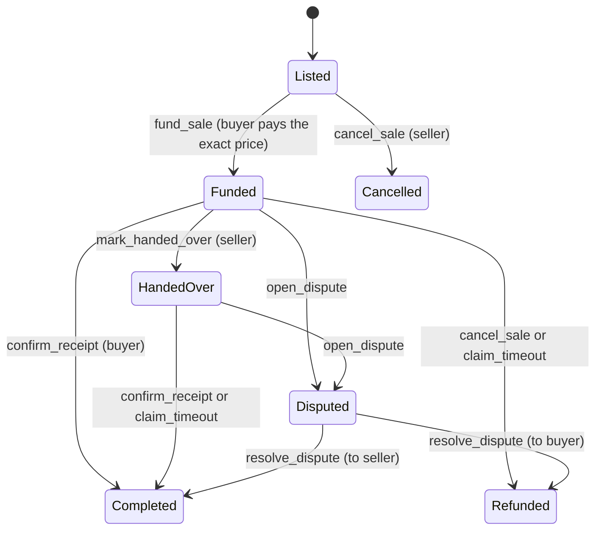
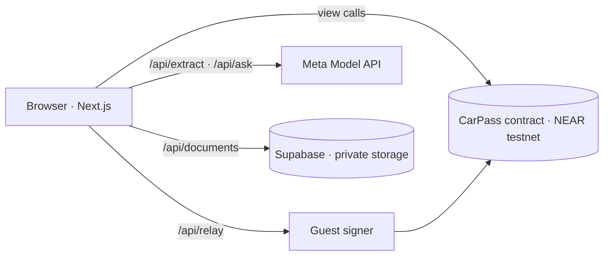

# CarPass

**A used-car passport and an escrowed sale, on NEAR testnet.**

Buying a used car means trusting a stack of loose invoices and an odometer that may have been rolled back, then handing over money before you are sure. CarPass puts the car's history and the sale on one page:

- **Evidence, not claims.** The seller photographs an invoice or report. An AI proposes the fields and quotes the words in the document that support each one; the seller reviews every field. The document's SHA-256 and the odometer reading go on chain.
- **Workshops vouch with their own account.** An approved workshop (a named NEAR account) confirms a record. The page always separates "confirmed by workshop" from "seller's claim".
- **Odometer conflicts are flagged by the contract.** A later document with fewer kilometres is kept and marked. Nobody is accused and no reading is silently dropped.
- **Questions answered only from the records.** "Any accidents?" gets an answer with citations, or "no recorded evidence". Never a guess.
- **Escrowed sale.** The buyer pays testnet NEAR into the contract. It is released when the buyer confirms receipt (a QR code at the handover), returned on cancel or timeout, or frozen by a dispute until a human reviewer decides.


> Testnet only. CarPass is a hackathon demo: not a government registry, not a mechanical inspection, not a binding sales contract and not a transfer of ownership.

## Try it

Open the demo and use **guest mode**: the bar at the top switches between four shared testnet accounts (seller, buyer, workshop, reviewer), so you can play both sides of a sale without a wallet.

A two-minute tour:

1. As **Buyer**, press *Pay into escrow* on the Toyota Corolla.
2. As **Seller**, press *I handed over the car*. A handover QR code appears.
3. As **Buyer**, press *I received the car*. The payment reaches the seller and the passport moves to the buyer; both transactions link to the explorer.
4. Still as Buyer (now the holder), add the sample *Service Invoice · 2025-05-10*. Its reading is lower than the last one, so the record is flagged as an odometer conflict and the record score drops.
5. Add the sample marked ⚑. It contains a line telling the AI to declare the car accident-free. The instruction is reported as a warning and ignored.
6. Press *Verify file* on any record: the browser downloads the stored copy, hashes it and compares it with the hash on chain.
7. Open the Hyundai Elantra and ask *Are there any recorded accidents?*

## What is real and what is simulated

| Part | Status |
|---|---|
| Smart contract, records, attestations, odometer flags | Real, on NEAR testnet |
| Escrow: hold, release, refund, timeout, dispute | Real transfers of **testnet** NEAR (no monetary value) |
| Document hashing and in-browser verification | Real |
| Document storage | Real (Supabase private bucket, reachable only by the server) |
| AI extraction and Q&A | Real when `META_MODEL_API_KEY` is set. Otherwise the header shows "AI on fallback": sample documents use stored readings, other uploads are filled in by hand, and Q&A returns plain facts from the chain. Fallbacks are always labelled. |
| Accounts | Guest mode signs with shared demo accounts on the server. Connecting your own wallet is not built yet. |
| Workshops, cars, invoices | Fictional samples |
| Dispute reviewer | A demo admin account. Its decision is not a legal ruling. |
| Legal ownership, payments in real money, KYC | Out of scope |

## On chain

| | |
|---|---|
| Network | NEAR testnet |
| Contract | [`carpass-v2.testnet`](https://testnet.nearblocks.io/address/carpass-v2.testnet) |
| Deploy | [`Dhw9vpDi…`](https://testnet.nearblocks.io/txns/Dhw9vpDivVdxVTZzpWjDAtBWMVCXrwmqH41CaGe8ehyG) |
| Sample record added | [`9h8k753s…`](https://testnet.nearblocks.io/txns/9h8k753sg7NzgJYoXzgUR2PXVD3GXw22JJxMSoZf1Fqp) |
| Workshop attestation | [`CyKjvLqN…`](https://testnet.nearblocks.io/txns/CyKjvLqNhjZwJWeoVqxrtbvbJmKCKgFSFq4ZMk7Q4tct) |
| Listing | [`FNmBuVqe…`](https://testnet.nearblocks.io/txns/FNmBuVqejwo3a6PE73bUcXfSvhjQoi1Bxzut7xRf3jCU) |

The contract stores document hashes, dates, odometer readings, account ids and sale state. It never stores a VIN (only a salted hash), a name, a file or any other personal data.

### Sale states



Every settlement writes the final state before it sends the payment, so a sale cannot pay out twice. The demo contract uses a two-minute stage timeout so `claim_timeout` can be shown live.

### Record score

A fixed formula over on-chain numbers, shown with its breakdown. It measures how complete and independently confirmed the record is, not the condition of the car.

```
40 × workshop-confirmed records / all records
+ 25 × min(records / 6, 1)
+ 20 if there is no odometer conflict
+ 15 × min(seller's completed sales / 3, 1)
```

## How the AI is kept in its place

- It has no tools. It cannot sign, pay, release funds or settle a dispute.
- Document text is treated as data. Instructions inside a document are reported as warnings, not followed.
- Every extracted value must come with a quote from the document; a value without one is dropped.
- Nothing is recorded until a person has reviewed the fields.
- Q&A sees only the passport's records. Citations that point at a record that does not exist are discarded, and an answer with no valid citation becomes "no recorded evidence".

## Architecture



- `contract/` — Rust, `near-sdk` 5. Passports, records, attestations, escrowed sale. 49 unit tests.
- `web/` — Next.js (App Router), TypeScript, Tailwind, React Three Fiber. English and Arabic (RTL).
- `scripts/` — deploy the contract, seed the demo, regenerate the sample documents.
- `docs/PLAN.md` — the build plan (Arabic).

A stored document is only ever served if its hash is registered on chain for that passport, so the contract decides what belongs to a car, not the upload endpoint.

## Run it locally

Requirements: Node 22, Rust with the `wasm32-unknown-unknown` target.

```bash
# 1. Contract
cd contract
cargo test
cargo build --target wasm32-unknown-unknown --release

# 2. Deploy your own copy to testnet (creates accounts through the faucet)
cd ../scripts
npm install
CARPASS_PREFIX=mycarpass node deploy.mjs      # keys are written to scripts/.keys.json (git-ignored)

# 3. Web app
cd ../web
npm install
cp .env.example .env.local                    # fill in the values; see the comments in the file
npm run dev

# 4. Seed the sample passports
cd ../scripts
CARPASS_PREFIX=mycarpass node seed.mjs
```

Checks:

```bash
cd web && npm run lint && npm run typecheck && npm test && npm run build
cd contract && cargo test
```

`GET /api/health` reports which parts are live (chain, guest accounts and their balances, AI, storage) without exposing any secret.

## Limits

- Guest accounts are shared, so visitors see each other's actions. The server signs only an allow-list of contract methods and decides deposits itself.
- A dispute records only the hash of the complaint; the reviewer hears the parties off-chain.
- Uploads are images (JPEG, PNG, WebP) up to 5 MB. Anyone viewing a passport can open its documents.
- The contract has no upgrade or migration path; a schema change means a new contract account.
- Not audited.

## بالعربي

CarPass جواز للسيارة المستعملة مع بيع آمن على NEAR Testnet: البائع يرفع فواتير الصيانة، ويقترح AI البيانات مع اقتباس من المستند ثم يراجعها البائع، وتُسجَّل بصمة المستند وقراءة العدّاد على السلسلة. الورشة توثّق السجل بحسابها، والعقد يعلّم تعارض العدّاد. المشتري يدفع NEAR تجريبيًا إلى العقد، ولا يصل للبائع إلا بعد تأكيد الاستلام، أو يُردّ عند الإلغاء أو انتهاء المهلة، أو يتجمّد عند النزاع حتى يقرر مراجع بشري. الواجهة بالعربية والإنجليزية. شبكة تجريبية فقط، وليس سجلًا حكوميًا ولا نقل ملكية.

## License

MIT
