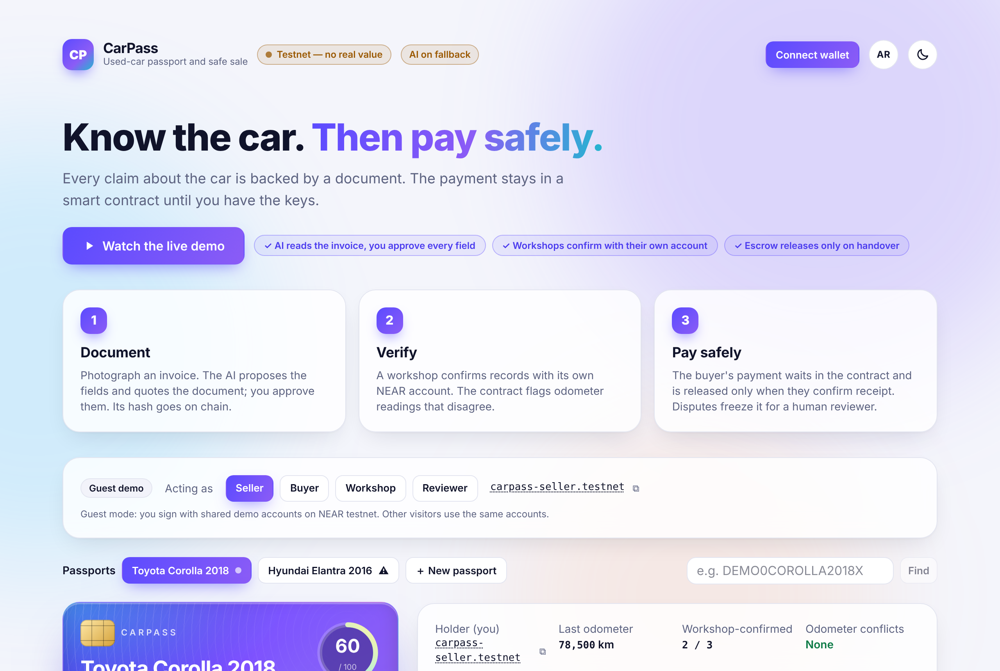
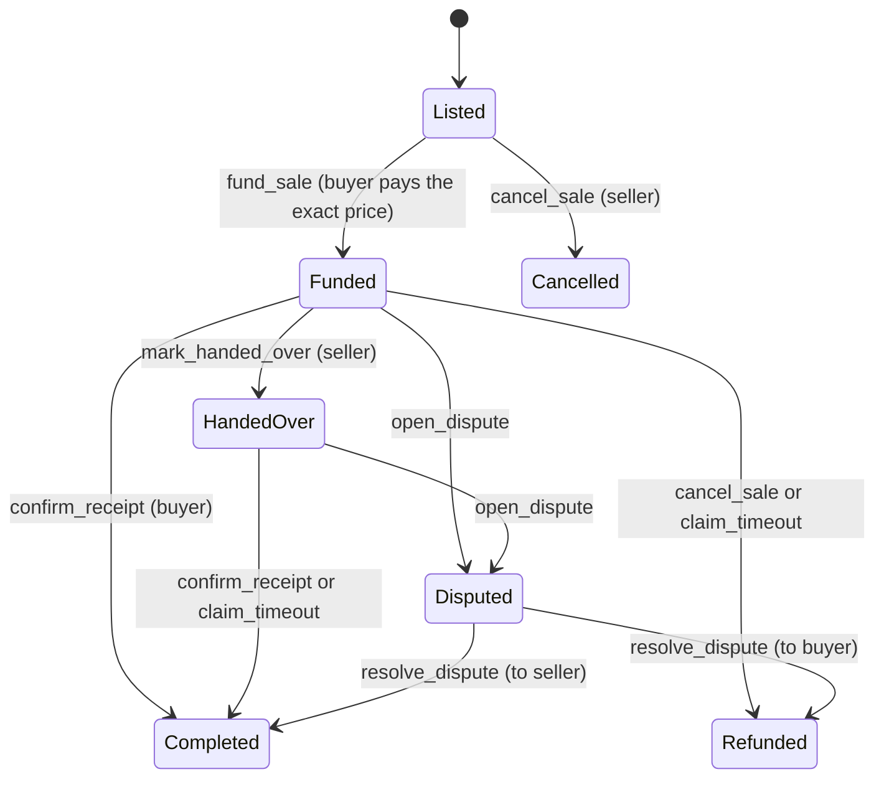
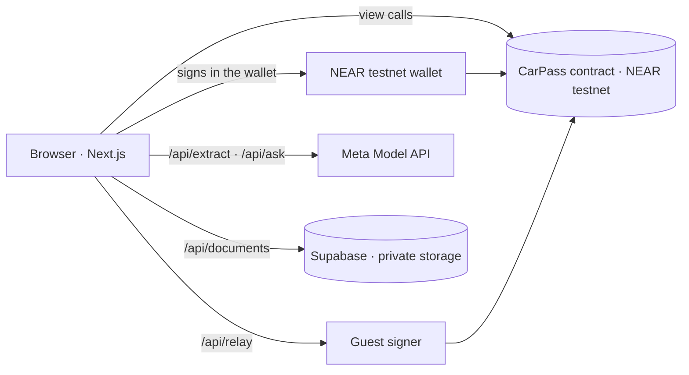

# CarPass

**A used-car passport and an escrowed sale, on NEAR testnet.**

**Live demo: https://carpass-near.vercel.app** — press *Watch the live demo* and the site runs itself.

Buying a used car means trusting a stack of loose invoices and an odometer that may have been rolled back, then handing over money before you are sure. CarPass puts the car's history and the sale on one page:

- **Evidence, not claims.** The seller photographs an invoice or report. An AI proposes the fields and quotes the words in the document that support each one; the seller reviews every field. The document's SHA-256 and the odometer reading go on chain.
- **Workshops vouch with their own account.** An approved workshop (a named NEAR account) confirms a record. The page always separates "confirmed by workshop" from "seller's claim".
- **Odometer conflicts are flagged by the contract.** A later document with fewer kilometres is kept and marked. Nobody is accused and no reading is silently dropped.
- **Questions answered only from the records.** "Any accidents?" gets an answer with citations, or "no recorded evidence". Never a guess.
- **Escrowed sale.** The buyer pays testnet NEAR into the contract. It is released when the buyer confirms receipt (a QR code at the handover), returned on cancel or timeout, or frozen by a dispute until a human reviewer decides.



> Testnet only. CarPass is a hackathon demo: not a government registry, not a mechanical inspection, not a binding sales contract and not a transfer of ownership.

## Try it

**The fastest way: press *Watch the live demo*.** The site then drives itself through the whole product in about two minutes, with nothing staged: it opens a fresh passport, has the AI read two invoices and registers their hashes, has the workshop confirm one, lists the car, pays into escrow, hands over, releases the payment, adds an invoice with a lower odometer reading (flagged as a conflict), asks the records a question and checks a stored file against its on-chain hash. Each step shows its transaction with a link to the explorer.

To drive it yourself there are two ways in:

- **Guest demo** (no wallet): the bar under the hero switches between four shared testnet accounts (seller, buyer, workshop, reviewer), so you can play both sides of a sale.
- **Your own wallet**: press *Connect wallet* and pick a wallet that supports NEAR testnet (Meteor, Intear, Nightly, Ledger and others). You then act as your own account: your passports, your listings, your purchases, each approved in your wallet. Testnet NEAR is free from https://near-faucet.io.

The page opens in English with a light theme. The round buttons in the header switch to Arabic (right-to-left) and to a dark theme; both choices are remembered.

Things to try by hand:

1. As **Buyer**, press *Pay into escrow* on the Toyota Corolla. As **Seller**, press *I handed over the car*; a handover QR code appears. As **Buyer**, press *I received the car*: the payment reaches the seller and the passport moves.
2. As the holder, add the sample *Service Invoice · 2025-05-10*. Its reading is lower than the last one, so the record is flagged as an odometer conflict and the record score drops.
3. Add the sample marked ⚑. It contains a line telling the AI to declare the car accident-free. The AI reports the instruction as a warning and does not follow it.
4. Press *Verify file* on any record: the browser downloads the stored copy, hashes it and compares it with the hash on chain.
5. Open the Hyundai Elantra and ask *Are there any recorded accidents?*
6. Type `DEMO0COROLLA2018X` into *Find by VIN*: a buyer who knows a car's VIN can look its passport up.

## What is real and what is simulated

| Part | Status |
|---|---|
| Smart contract, records, attestations, odometer flags | Real, on NEAR testnet |
| Escrow: hold, release, refund, timeout, dispute | Real transfers of **testnet** NEAR (no monetary value) |
| Document hashing and in-browser verification | Real |
| Document storage | Real (Supabase private bucket, reachable only by the server) |
| AI extraction and Q&A | Real on the live site (Meta Model API, `muse-spark-1.3-contributor`). Without `META_MODEL_API_KEY` the header shows "AI on fallback": sample documents use stored readings, other uploads are filled in by hand, and Q&A returns plain facts from the chain. Fallbacks are always labelled. |
| Accounts | Your own NEAR testnet wallet (through NEAR Connect), or guest mode, which signs with shared demo accounts on the server. |
| Workshops, cars, invoices | Fictional samples |
| Dispute reviewer | A demo admin account. Its decision is not a legal ruling. |
| Legal ownership, payments in real money, KYC | Out of scope |

## On chain

| | |
|---|---|
| Network | NEAR testnet |
| Contract | [`carpass-v5.testnet`](https://testnet.nearblocks.io/address/carpass-v5.testnet) |
| Deploy | [`6E4cBRFc…`](https://testnet.nearblocks.io/txns/6E4cBRFcKXLZZTwc8w2dRhTCPQrhDiHzW5vKPRnoXGTP) |

The contract stores document hashes, dates, odometer readings, account ids and sale state. It never stores a VIN (only a salted hash), a name, a file or any other personal data.

### Sale states



Every settlement writes the final state before it sends the payment, so a sale cannot pay out twice. Each payment is followed by a callback: if the transfer did not arrive, the amount is recorded as owed to the recipient, who can claim it with `withdraw_owed`. Listing costs 0.01 NEAR, which pays for the sale record's storage. The demo contract uses a two-minute stage timeout so `claim_timeout` can be shown live.

### Odometer rule

A new reading is compared with every clean reading already on the passport, whatever order the documents were added in: an earlier-dated document must not show more kilometres and a later-dated one must not show fewer. Readings dated the same day are not compared. A document (by hash) can be registered on a passport only once.

### Record score

A fixed formula over on-chain numbers, shown with its breakdown. It measures how complete and independently confirmed the record is, not the condition of the car.

```
40 × workshop-confirmed records / all records
+ 25 × min(records / 6, 1)
+ 20 if at least two odometer readings exist and none conflict ("not enough readings" otherwise)
+ 15 × min(seller's completed sales / 3, 1)
```

## How the AI is kept in its place

- It has no tools. It cannot sign, pay, release funds or settle a dispute.
- Document text is treated as data. Instructions inside a document are reported as warnings, not followed.
- Every extracted value must come with a quote from the document; a value without one is dropped.
- Nothing is recorded until a person has reviewed the fields.
- Q&A sees only the passport's records. Citations that point at a record that does not exist are discarded, and an answer with no valid citation becomes "no recorded evidence".

## Architecture



- `contract/` — Rust, `near-sdk` 5. Passports, records, attestations, escrowed sale. 57 unit tests.
- `web/` — Next.js (App Router), TypeScript, Tailwind, React Three Fiber, NEAR Connect. English and Arabic (RTL), light and dark themes.
- `scripts/` — deploy the contract, seed the demo, run the testnet smoke test, regenerate the sample documents.
- `supabase/migrations/` — the database schema, row-level security and rate-limit counters.
- `docs/PLAN.md` — the build plan (Arabic).

### Who can change what

- **Guest accounts stay inside the demo.** The server signs for a guest only on passports held by a demo account and sales whose parties are all demo accounts, and caps guest prices at 3 NEAR. It checks this, and works out any deposit, from on-chain data before it signs or moves funds. A wallet owner's passport, sale or dispute cannot be touched from guest mode.
- **Documents.** An upload is a pending copy that expires after an hour. It is served only once its hash is registered on chain for that passport, which only the holder or an approved workshop can do. From then on the copy and its reviewed fields are frozen. Stored fields are shown only while their type, date and odometer agree with the contract's record.
- **Published documents are public.** Anyone who opens a passport can view and download its documents; the uploader must confirm this before recording. There is no redacted copy or private original.
- **VIN.** Only a hash of the VIN is on chain. Anyone who already knows a VIN can compute the same hash and find its passport; that lookup is intended.
- **Rate limits** are counted in Postgres, shared by all server instances: per client and per service.

## Run it locally

Requirements: Node 22, Rust with the `wasm32-unknown-unknown` target.

```bash
# 1. Contract
cd contract
cargo test
cargo build --target wasm32-unknown-unknown --release   # .cargo/config.toml adds `--cfg near`

# 2. Deploy your own copy to testnet (creates accounts through the faucet)
cd ../scripts
npm install
CARPASS_PREFIX=mycarpass node deploy.mjs      # keys are written to scripts/.keys.json (git-ignored)

# 3. Database: apply supabase/migrations/*.sql to a Supabase project and create the server account they describe

# 4. Web app
cd ../web
npm install
cp .env.example .env.local                    # fill in the values; see the comments in the file
npm run dev

# 5. Seed the sample passports
cd ../scripts
CARPASS_PREFIX=mycarpass node seed.mjs
```

Checks:

```bash
cd web && npm run lint && npm run typecheck && npm test && npm run build
cd contract && cargo test
```

`GET /api/health` reports which parts are live (chain, guest accounts and their balances, AI, storage) without exposing any secret.

## Limits

- With a wallet, a workshop or reviewer role applies only if the contract admin approved that account. Wallet signing was tested by hand with Meteor on testnet, not in an automated test.
- The live demo accepts the AI's reading without the human review step, and says so. Each run adds a "Demo car" passport to the shared contract.
- Guest accounts are shared, so visitors see each other's actions inside the demo.
- Uploading does not require proof of who is uploading; what protects a passport is that only its holder or a workshop can register the hash. Someone holding the same file could store their own summary for it in the moments before the holder registers it.
- If a wallet owner buys a demo-held car and a dispute follows, only the contract admin can settle it, not the guest reviewer.
- A dispute records only the hash of the complaint; the reviewer hears the parties off-chain.
- Uploads are images (JPEG, PNG, WebP) up to 5 MB. Anyone viewing a passport can open its documents.
- The contract has no upgrade or migration path; a schema change means a new contract account.
- Not audited.

## بالعربي

CarPass جواز للسيارة المستعملة مع بيع آمن على NEAR Testnet: البائع يرفع فواتير الصيانة، ويقترح AI البيانات مع اقتباس من المستند ثم يراجعها البائع، وتُسجَّل بصمة المستند وقراءة العدّاد على السلسلة. الورشة توثّق السجل بحسابها، والعقد يعلّم تعارض العدّاد. المشتري يدفع NEAR تجريبيًا إلى العقد، ولا يصل للبائع إلا بعد تأكيد الاستلام، أو يُردّ عند الإلغاء أو انتهاء المهلة، أو يتجمّد عند النزاع حتى يقرر مراجع بشري. الواجهة بالعربية والإنجليزية. شبكة تجريبية فقط، وليس سجلًا حكوميًا ولا نقل ملكية.

## License

MIT
